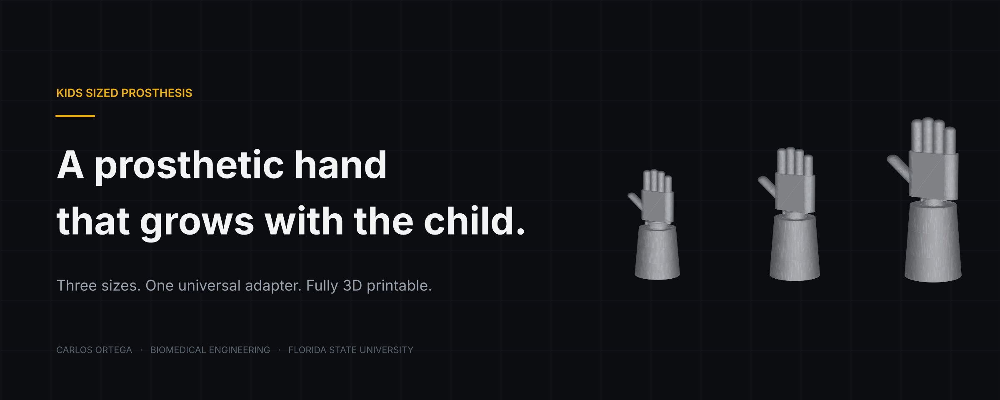
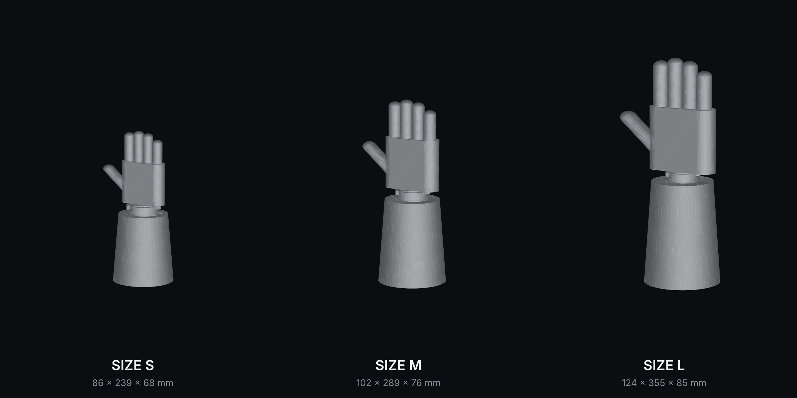
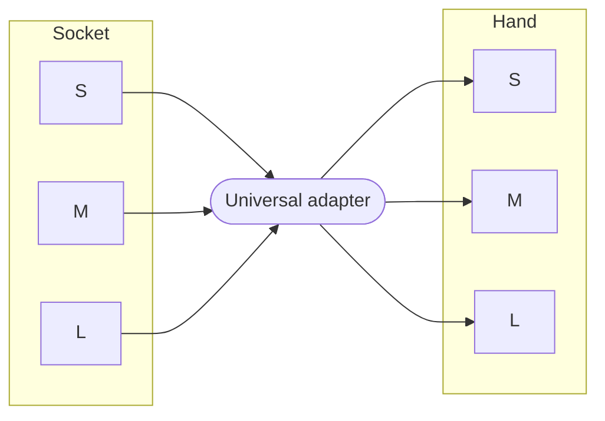

<p align="center">
  
</p>

<p align="center">
  
  
  
  
</p>

<p align="center">
  <a href="#the-problem">Problem</a> ·
  <a href="#the-solution">Solution</a> ·
  <a href="#system-architecture">Architecture</a> ·
  <a href="#specifications">Specs</a> ·
  <a href="#files">Files</a> ·
  <a href="#roadmap">Roadmap</a>
</p>

---

## The problem

Kids grow. Prostheses don't.

A growing child typically needs a new prosthesis every year.<sup>[1]</sup> Every replacement means a new fitting, a new build, and a new bill. The device is outgrown long before it wears out.

The family pays for the same hand over and over. The child spends weeks waiting between devices.

## The solution

Stop rebuilding the whole prosthesis. Swap only the part the child outgrew.

Kids Sized Prosthesis splits the device into three modules: **socket**, **universal adapter**, and **hand**. Hands and sockets come in three sizes. The adapter stays the same across all of them.

When the child grows, print the next size. Keep everything else.

<p align="center">
  
</p>

## Key characteristics

| | |
|---|---|
| **Modular** | Socket, adapter, and hand are separate parts. Replace one, keep the rest. |
| **Growth-mapped sizing** | S, M, and L are based on average pediatric hand dimensions at three major growth stages. |
| **One interface** | A single universal adapter connects every hand to every socket. No size-specific hardware. |
| **3D printable** | Every part prints on a standard desktop FDM printer. |
| **Open formats** | Native Fusion source plus STEP and STL. Edit it in any CAD tool or send it straight to a slicer. |

## System architecture



Any socket. Any hand. One connection point. Upgrading from M to L is a swap, not a rebuild.

## Specifications

Overall assembly envelope, measured from the exported STL files.

| Size | Width | Length | Depth | Length vs. S |
|:---:|---:|---:|---:|---:|
| **S** | 86 mm | 239 mm | 68 mm | 1.00× |
| **M** | 102 mm | 289 mm | 76 mm | 1.21× |
| **L** | 124 mm | 355 mm | 85 mm | 1.49× |

Each step up adds roughly 20% in width and 20 to 23% in length.

## Files

```
kids-sized-prosthesis/
├── cad/
│   ├── fusion/      Native Fusion 360 source (.f3d)
│   └── step/        Neutral CAD exchange (.step)
├── stl/
│   ├── small/       Print-ready mesh, Size S
│   ├── medium/      Print-ready mesh, Size M
│   └── large/       Print-ready mesh, Size L
├── renders/         Images
├── docs/            Design notes, sizing data, bill of materials
└── testing/         Fit and print test results
```

**Preview in 3D:** open any STL below. GitHub renders it in an interactive viewer.

| Size | Fusion | STEP | STL |
|:---:|:---:|:---:|:---:|
| S | [Size_S.f3d](cad/fusion/Size_S.f3d) | [Size_S.step](cad/step/Size_S.step) | [Size_S.stl](stl/small/Size_S.stl) |
| M | [Size_M.f3d](cad/fusion/Size_M.f3d) | [Size_M.step](cad/step/Size_M.step) | [Size_M.stl](stl/medium/Size_M.stl) |
| L | [Size_L.f3d](cad/fusion/Size_L.f3d) | [Size_L.step](cad/step/Size_L.step) | [Size_L.stl](stl/large/Size_L.stl) |

## Roadmap

- [x] Size S, M, L hand and socket models
- [x] Native, STEP, and STL exports
- [ ] Universal adapter as a standalone part
- [ ] Sizing data table by age group
- [ ] Print settings and bill of materials
- [ ] Fit and print testing
- [ ] Conference presentation

## Author

**Carlos Ortega**
Biomedical Engineering, Florida State University

## Disclaimer

This is a research and educational project. It is **not a certified medical device** and has not been clinically tested. Do not fit it to a patient without supervision from a licensed prosthetist.

---

<sub>[1] Rochester Institute of Technology, Multidisciplinary Senior Design: <a href="https://www.rit.edu/engineering/seniordesign/projects/adjustable-pediatric-prosthesis">Adjustable Pediatric Prosthesis</a>.</sub>
